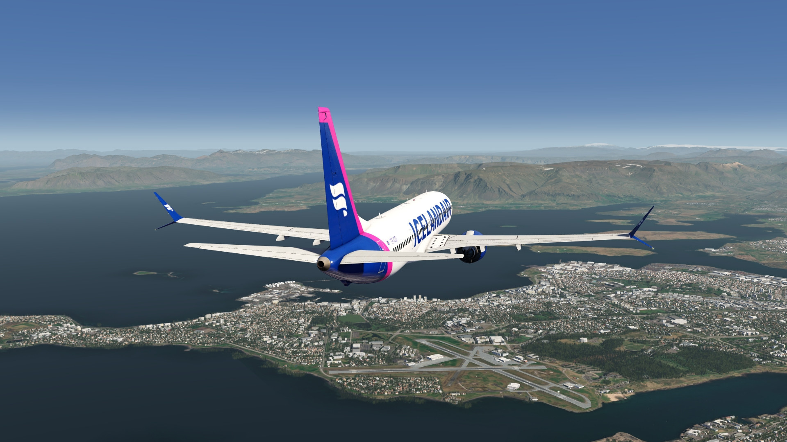
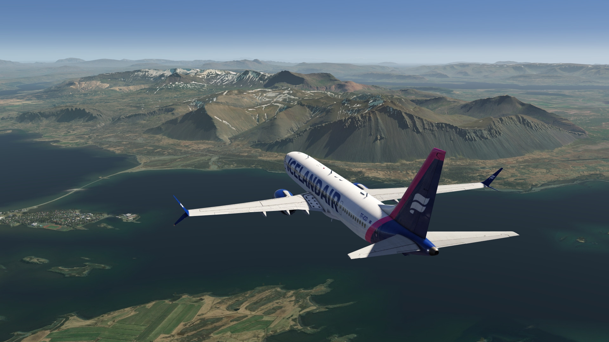
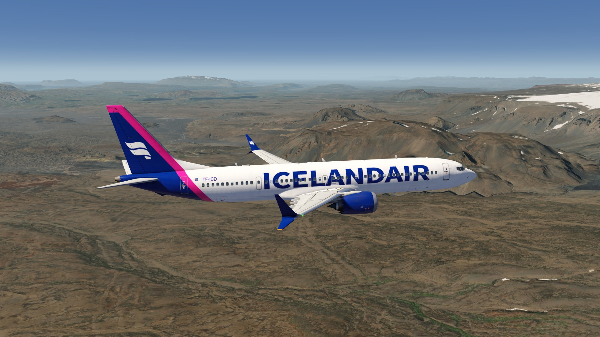
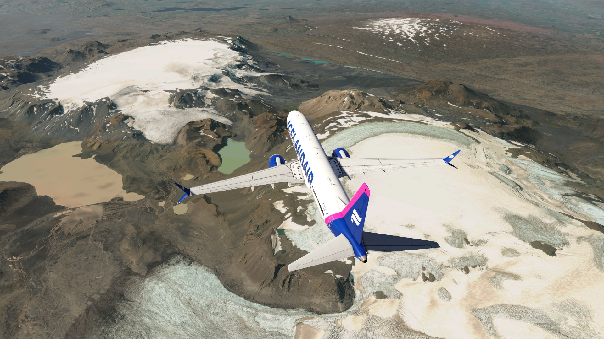
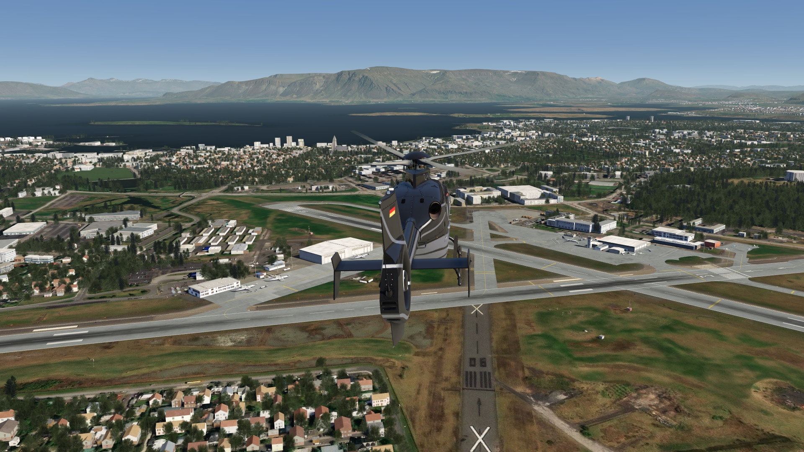

# Western Iceland Photo Scenery

## Description

HD photo scenery covering the western part of Iceland, incl. enlarged area of Reykjavik, capital of Iceland, Vestmannaeyjar and part of the volcanic island. 

A minor elevation fix has been added for Reykjavik and Vestmannaeyjar island airport.

### Part 1
- Reykjavik
- Stykkisholmur

### Part 2
- Vestmannaeyjar

FS4 Desktop
FSG Mobile

Photo Scenery
Elevation

v1.1

---

# Preview Images

  <a href="#!" class="lightbox-close">&times;</a>

  

  <a href="#!" class="lightbox-close">&times;</a>

  

  <a href="#!" class="lightbox-close">&times;</a>

  

  <a href="#!" class="lightbox-close">&times;</a>

  

---

# Coverage

  <a href="#!" class="lightbox-close">&times;</a>

  

  <a href="#!" class="lightbox-close">&times;</a>

  

---

# FS4 Desktop Downloads (zip)

<a class="download-button" href="https://drive.google.com/file/d/1P5As6Zs94HLC1DR9kpZ25MhATtUHzGT5/view?usp=drive_link">
Download Images - Part 1 (2.81 GB)
</a>

<a class="download-button" href="https://drive.google.com/file/d/1oWEOGBi_C-SZIsFP5Iau3-2cSZw8UQni/view?usp=drive_link">
Download Images - Part 2 (682 MB)
</a>

<a class="download-button" href="https://drive.google.com/file/d/1Q9BqQ63Ur-icE_mf88XzQ-FXpbLz1CfY/view?usp=drive_link">
Download Data FS4 (813 KB)
</a>

---

# FSG Mobile Downloads (tme)

<a class="download-button" href="https://drive.google.com/file/d/1GTmsekA_4is8Qf0QvQIotqs16A4ZZjVZ/view?usp=drive_link">
Download Images - Part 1 (2.44 GB)
</a>

<a class="download-button" href="https://drive.google.com/file/d/1-pXwHXowJgMkPgf5jWapbzbkWh0zas6u/view?usp=drive_link">
Download Images - Part 2 (682.1 MB)
</a>

<a class="download-button" href="https://drive.google.com/file/d/1K2SrrmbP5JMF3LvYMhMO5EN3AidUOAjQ/view?usp=drive_link">
Download Data FSG (381 KB)
</a>

---

# References

- ArcGIS Maps © 
- OpenTopography - Copernicus Global 30m data © 
- Carto Basemaps - OpenStreetMap © 

---

# Credits

- nickhod for AeroScenery (creating photo-sceneries)

---

# Installation

- [FS4 Desktop Installation](../install/fs4.html)
- [FSG Mobile Installation](../install/fsg.html)

---

# License

- [License Information](../license/license.html)