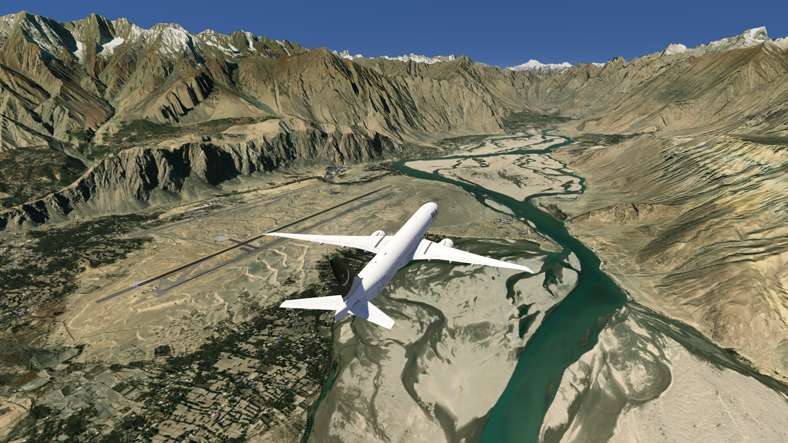
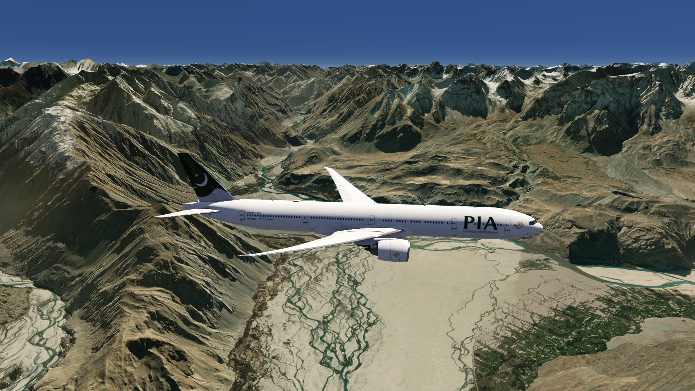
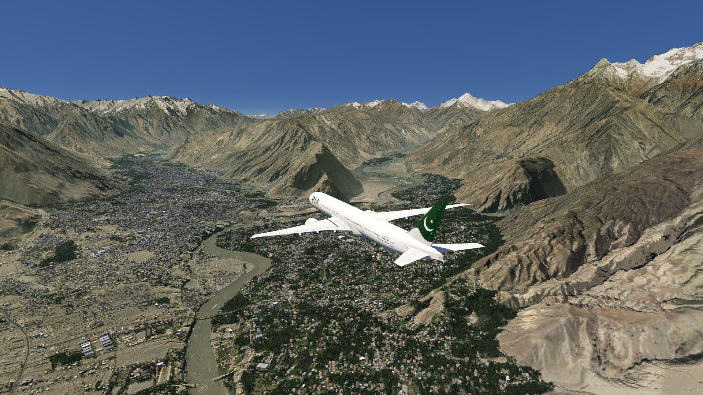
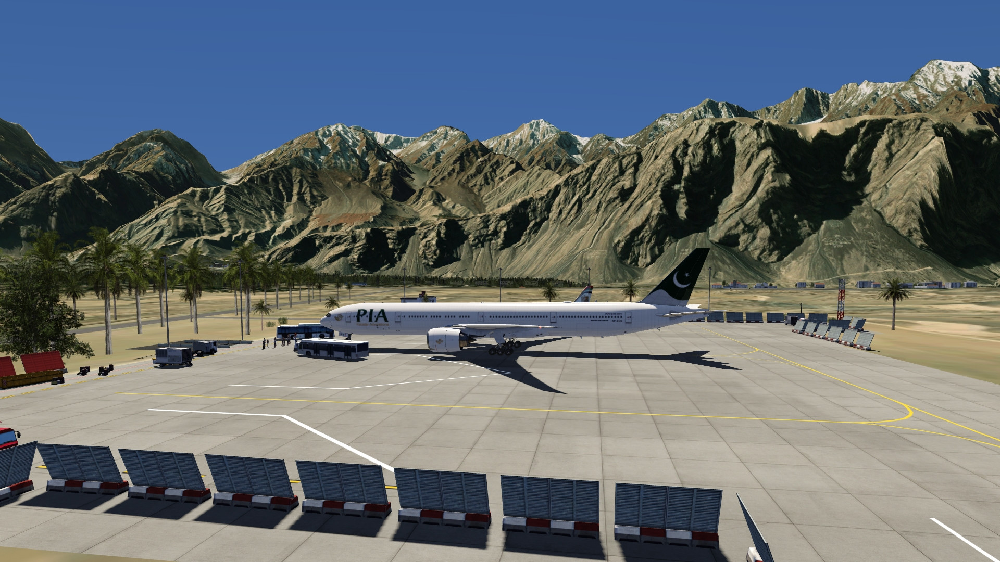
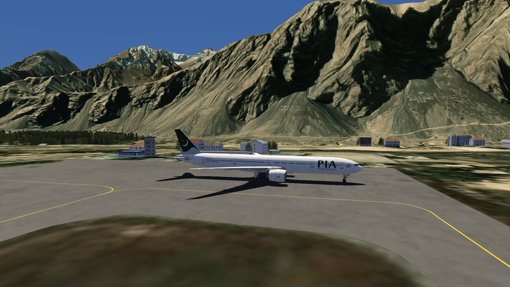
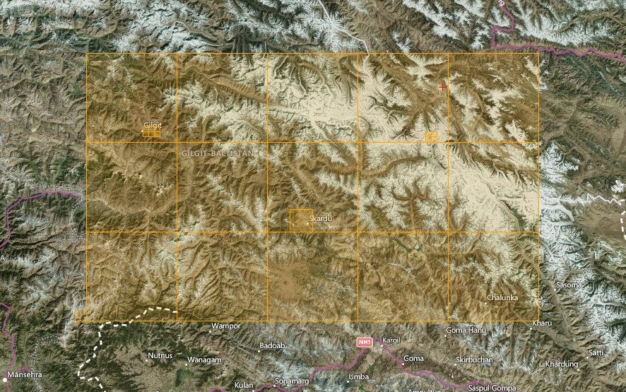

# Skardu Mountain Photo Scenery

## Description

HD photo scenery featuring the stunning mountain area around Skardu, including K2 and Gilgit area.

Skardu Airport has been created by A7.

FS4 Desktop
FSG Mobile

Photo Scenery

v1.0

---

# Preview Images

  <a href="#!" class="lightbox-close">&times;</a>

  

  <a href="#!" class="lightbox-close">&times;</a>

  

  <a href="#!" class="lightbox-close">&times;</a>

  

  <a href="#!" class="lightbox-close">&times;</a>

  

---

# Coverage

  <a href="#!" class="lightbox-close">&times;</a>

  

---

# FS4 Desktop Downloads (zip)

<a class="download-button" href="https://drive.google.com/file/d/1Y6lxx6ZEap50KzWTILfoOGfwVzH0DR6o/view?usp=drive_link">
Download Images (2.92 GB)
</a>

<a class="download-button" href="https://drive.google.com/file/d/1hEcKMD3P95WaO13G2cauTsEOgyInvVr7/view?usp=drive_link">
Download Data FS4 (599 KB)
</a>

---

# FSG Mobile Downloads (tme)

<a class="download-button" href="https://drive.google.com/file/d/1RqAJ6ukswVFh4nwmqc8aDdBWQk0CZNOK/view?usp=drive_link">
Download Images (2.79 GB)
</a>

<a class="download-button" href="https://drive.google.com/file/d/1Mu9f5-uFxXP2qDqDZLTaZdl_AkyjXX-3/view?usp=drive_link">
Download Data FSG (571 KB)
</a>

---

# References

- Bing Maps © / ArcGIS Maps ©
- Carto Basemaps - OpenStreetMap ©
- OpenTopography - Copernicus Global 30m data © 
- SketchUp 3D Warehouse (3dwarehouse.sketchup.com)

---

# Credits

- nickhod for AeroScenery (creating photo-sceneries)
- A7 for Skardu Airport

---

# Installation

- [FS4 Desktop Installation](../install/fs4.html)
- [FSG Mobile Installation](../install/fsg.html)

---

# License

- [License Information](../license/license.html)